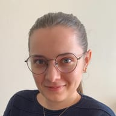

<p align="center">
  <picture>
    <source
      media="(prefers-color-scheme: dark)"
      srcset="https://capsule-render.vercel.app/api?type=waving&height=170&color=0F172A&text=TACME&section=header&fontAlign=50&fontSize=52&fontColor=FFFFFF&animation=fadeIn&fontAlignY=35"
    >
    <source
      media="(prefers-color-scheme: light)"
      srcset="https://capsule-render.vercel.app/api?type=waving&height=170&color=D1D5DB&text=TACME&section=header&fontAlign=50&fontSize=52&fontColor=0F172A&animation=fadeIn&fontAlignY=35"
    >
    
  </picture>
</p>

<h3 align="center">
  <strong>T</strong>ask-Aware
  <strong>C</strong>ross-Modal
  <strong>E</strong>xperts for Disjoint-Corpus
  <strong>M</strong>ultimodal Behavioral Understanding
</h3>

<!-- BEGIN PROJECT BADGES -->

<!-- prettier-ignore-start -->
<table align="center">
  <tr>
    <td width="150"><strong>Project</strong></td>
    <td> <a href="LICENSE"></a> </td>
  </tr>
  <tr>
    <td width="150"><strong>Runtime</strong></td>
    <td>          </td>
  </tr>
  <tr>
    <td width="150"><strong>Build&nbsp;Tooling</strong></td>
    <td>  </td>
  </tr>
  <tr>
    <td width="150"><strong>Code&nbsp;Quality</strong></td>
    <td>     </td>
  </tr>
  <tr>
    <td width="150"><strong>Repository</strong></td>
    <td>  <a href="https://github.com/DmitryRyumin/TACME/graphs/contributors"></a></td>
  </tr>
  <tr>
    <td width="150"><strong>Community</strong></td>
    <td><a href="https://github.com/DmitryRyumin/TACME/stargazers"></a> <a href="https://github.com/DmitryRyumin/TACME/forks"></a> <a href="https://github.com/DmitryRyumin/TACME/issues"></a></td>
  </tr>
  <tr>
    <td width="150"><strong>Hugging&nbsp;Face</strong></td>
    <td><a href="https://dmitryryumin-tacme.hf.space"></a> <a href="https://huggingface.co/DmitryRyumin/TACME"></a></td>
  </tr>
</table>
<!-- prettier-ignore-end -->

<!-- END PROJECT BADGES -->

---

## Authors

<!-- BEGIN AUTHORS -->

<!-- prettier-ignore-start -->
<table align="center">
  <tr>
    <td align="center" valign="top" width="33%"><br><strong>Dr. Elena Ryumina</strong><br><br><sub><a href="https://github.com/ElenaRyumina">GitHub</a>&nbsp;·&nbsp;<a href="https://www.webofscience.com/wos/author/record/2779050">Web of Science</a>&nbsp;·&nbsp;<a href="https://www.scopus.com/authid/detail.uri?authorId=57220572427">Scopus</a>&nbsp;·&nbsp;<a href="https://scholar.google.com/citations?user=DOBkQssAAAAJ">Google Scholar</a>&nbsp;·&nbsp;<a href="https://orcid.org/0000-0002-4135-6949">ORCID · 0000-0002-4135-6949</a>&nbsp;·&nbsp;<a href="https://huggingface.co/ElenaRyumina">Hugging Face</a>&nbsp;·&nbsp;<a href="https://t.me/ryuminaev">Telegram</a>&nbsp;·&nbsp;<a href="mailto:evryumina@hse.ru">Email</a></sub></td>
    <td align="center" valign="top" width="33%"><br><strong>Dr. Alexandr Axyonov</strong><br><br><sub><a href="https://github.com/AlexandrAxyonov">GitHub</a>&nbsp;·&nbsp;<a href="https://www.webofscience.com/wos/author/record/2224927">Web of Science</a>&nbsp;·&nbsp;<a href="https://www.scopus.com/authid/detail.uri?authorId=57203963345">Scopus</a>&nbsp;·&nbsp;<a href="https://scholar.google.com/citations?user=Hs95wd4AAAAJ">Google Scholar</a>&nbsp;·&nbsp;<a href="https://orcid.org/0000-0002-7479-2851">ORCID · 0000-0002-7479-2851</a>&nbsp;·&nbsp;<a href="https://t.me/MiSTe_R">Telegram</a>&nbsp;·&nbsp;<a href="mailto:aaxyonov@hse.ru">Email</a></sub></td>
    <td align="center" valign="top" width="33%"><br><strong>Dr. Dmitry Ryumin</strong><br><br><sub><a href="https://github.com/DmitryRyumin">GitHub</a>&nbsp;·&nbsp;<a href="https://dmitryryumin.github.io">Website</a>&nbsp;·&nbsp;<a href="https://www.webofscience.com/wos/author/record/K-7989-2018">Web of Science</a>&nbsp;·&nbsp;<a href="https://www.scopus.com/authid/detail.uri?authorId=57191960214">Scopus</a>&nbsp;·&nbsp;<a href="https://scholar.google.com/citations?user=LrTIp5IAAAAJ">Google Scholar</a>&nbsp;·&nbsp;<a href="https://orcid.org/0000-0002-7935-0569">ORCID · 0000-0002-7935-0569</a>&nbsp;·&nbsp;<a href="https://huggingface.co/DmitryRyumin">Hugging Face</a>&nbsp;·&nbsp;<a href="https://t.me/dmitry_ryumin">Telegram</a>&nbsp;·&nbsp;<a href="mailto:neweraairesearch@gmail.com">Email</a></sub></td>
  </tr>
</table>
<!-- prettier-ignore-end -->

<!-- END AUTHORS -->

---

## Citation

If you use TACME in your research or build upon this project, please cite our EMNLP 2026 Findings paper:

**Elena Ryumina, Alexandr Axyonov, and Dmitry Ryumin (2026).**
_TACME: Task-Aware Cross-Modal Experts for Disjoint-Corpus Multimodal Behavioral Understanding._
Findings of the Association for Computational Linguistics: EMNLP 2026, pp. 20210–20234.

[Paper (ACL Anthology)](https://aclanthology.org/2026.findings-emnlp.957/) · [PDF](https://aclanthology.org/2026.findings-emnlp.957.pdf) · [DOI](https://doi.org/10.18653/2026.findings-emnlp.957)

```bibtex
@inproceedings{ryumina-etal-2026-tacme,
    title = "{TACME}: Task-Aware Cross-Modal Experts for Disjoint-Corpus Multimodal Behavioral Understanding",
    author = "Ryumina, Elena and Axyonov, Alexandr and Ryumin, Dmitry",
    booktitle = "Findings of the {A}ssociation for {C}omputational {L}inguistics: {EMNLP} 2026",
    month = oct,
    year = "2026",
    address = "Budapest, Hungary",
    publisher = "Association for Computational Linguistics",
    pages = "20210--20234",
    url = "https://aclanthology.org/2026.findings-emnlp.957/",
    doi = "10.18653/2026.findings-emnlp.957"
}
```

---

## License

This project is released under the **MIT License**.

See [LICENSE](LICENSE) for details.
